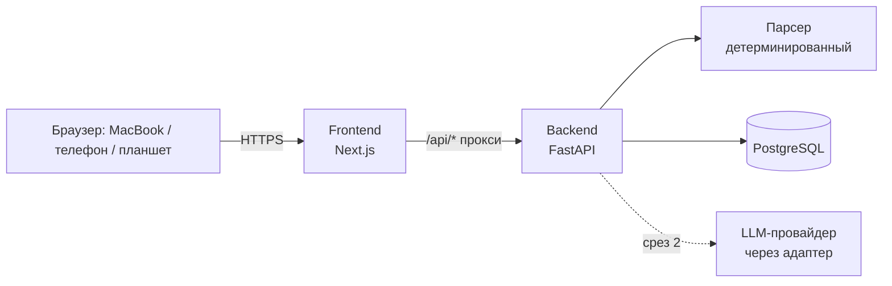
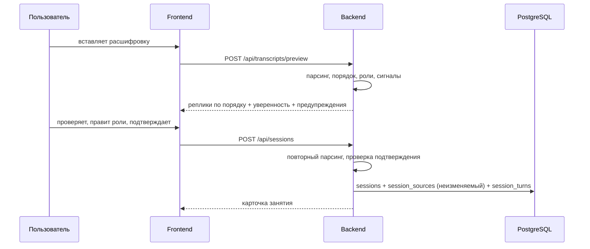

# Архитектура

## Компоненты

- **Frontend** — Next.js, TypeScript. Браузер обращается только к своему origin; `/api/*` проксируется на backend. Ключи и база браузеру недоступны.
- **Backend** — FastAPI, SQLAlchemy 2, Alembic, Pydantic. Вся логика, валидация, расчёт метрик.
- **Парсер** — чистая функция без LLM: `parse_transcript(raw, order, preferred) → ParseResult`. Подробно — [parser.md](parser.md).
- **PostgreSQL** — единственное хранилище. Все таблицы содержат `user_id`.

Микросервисов нет: два приложения и база. Обоснование — [ADR 0001](adr/0001-stack.md).

## Поток данных: приём занятия

Сервер не доверяет предпросмотру: при сохранении текст парсится заново, и если автоопределение неуверенное или расходится с выбранным порядком, без `confirmed=true` сохранение отклоняется (409).

## Модель данных (срез 1)

| Таблица | Назначение |
| --- | --- |
| `users`, `user_profiles` | пользователь и настройки: обычный порядок расшифровки, язык объяснений, анализ дисфлюентности (по умолчанию выключен) |
| `sessions` | занятие: название, дата, роль пользователя, рынок, результат парсинга, статистика, предупреждения |
| `session_sources` | исходный текст как есть, sha256; UPDATE запрещён триггером |
| `session_turns` | нормализованные реплики: позиция, роль, текст, длительность, строки в исходнике, флаги; поле `version` для повторной нормализации |
| `audit_events` | журнал создания и удаления |

Остальные сущности ТЗ (Error, ErrorOccurrence, VocabularyItem, Exercise, ModelRun, CostRecord и т. д.) добавляются миграциями в своих срезах.

## AI-пайплайн (план, срез 2)

1. ingestion → 2. parsing → 3. восстановление порядка → 4. роли → 5. предпросмотр — **готово**.
6. normalization → 7. контекст → 8–10. лингвистический и интервью-анализ (LLM, JSON по схеме) → 11. сверка с банком ошибок → 12. расчёт метрик кодом → 13–14. план и упражнения → 15. сохранение → 16. отчёт.

Правила: модель возвращает JSON по версионируемой схеме; фрагмент-доказательство каждого замечания проверяется кодом на дословное вхождение в реплику; числа считает код; каждый прогон сохраняется как новая версия; токены и стоимость логируются, лимит на занятие. Требования к модели — [llm-requirements.md](llm-requirements.md).

## Развёртывание

Сейчас — локально (Docker Compose или вручную). Для доступа с телефона нужен постоянный сервер (VPS) с управляемой или собственной PostgreSQL и HTTPS — этап 4. Код от этого не меняется: адреса задаются переменными окружения.
